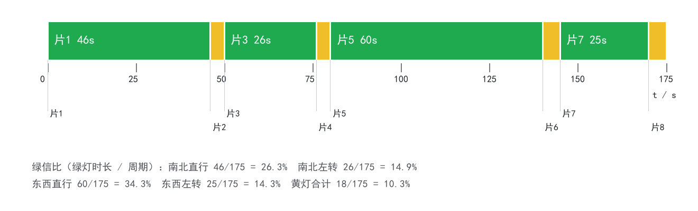
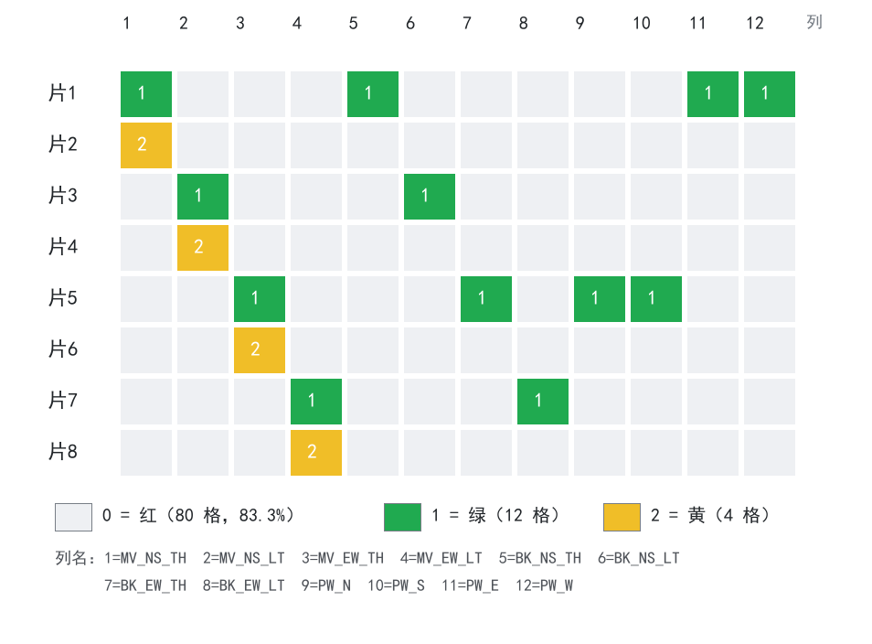
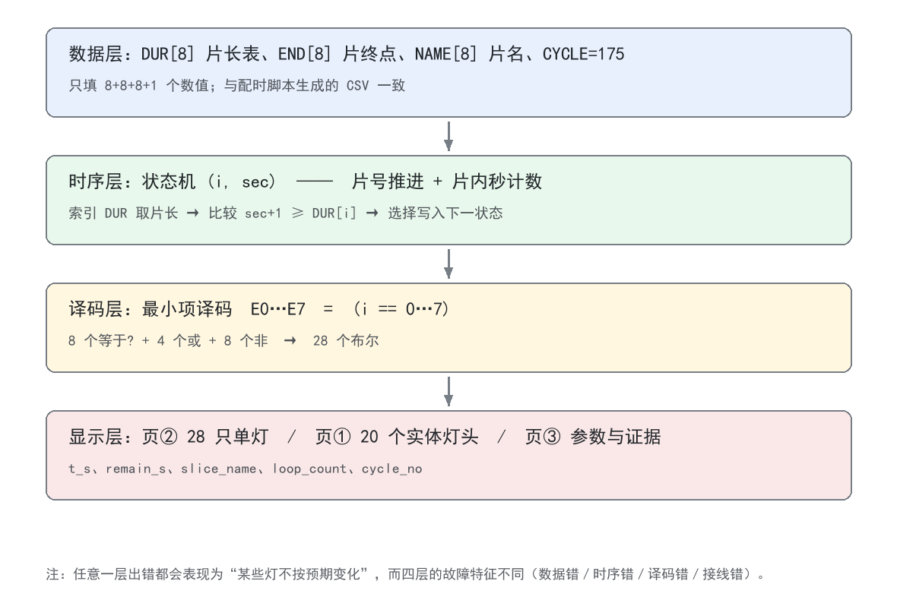
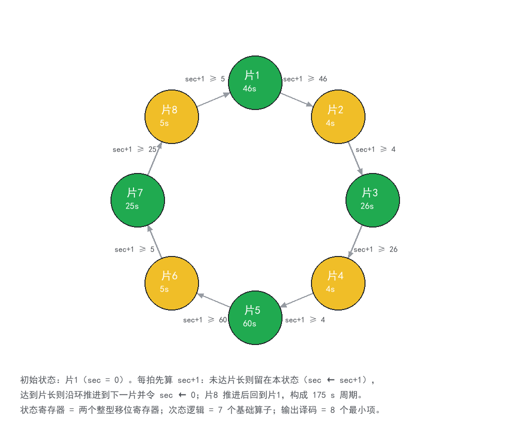

# 城市十字路口信号灯仿真系统的设计与结构优化

## ——从查表法到有限状态机的实现演进

**摘要**　本文以某城市十字路口的实测信号配时为对象，在 LabVIEW 2014 图形化数据流环境中构建了 175 s 周期的信号灯仿真系统，并对其实现结构进行了两轮优化。系统经历了从 4 灯组基准版（V1）到 12 灯组完整版（V2）、再到结构优化版（V3.1）与时间基准重构版（V3.2）的演进。本文的重点不在"把灯点亮"，而在**用数字电路与软件工程的方法审视一张 8×12 的状态矩阵**：统计发现该矩阵 96 个单元中 80 个取值为 0（83.3%），12 个灯组仅呈现 8 种不同的列图样，且每个灯组的非零状态只落在一对相邻时间片上。据此将其解释为"4 个相位 × 2 个阶段（绿/黄）"的结构，进而按**真值表→最小项译码**的组合逻辑综合思路，把 96 格查表译码重构为 8 个最小项、4 个或门与 8 个非门，逻辑算子由 40 个降至 20 个，需人工填写的数值由约 162 个降至约 34 个，状态矩阵被完全取消。第二轮优化进一步把时间基准由"以秒数扫描配时表求片号"的纯函数映射，改写为"（片号，片内秒数）"二元状态的**有限状态机**（Moore 型），使每拍运算量由 O(8) 降为 O(1)，并消除了 While 循环内的 For 嵌套。两轮重构均以 175 s 逐秒灯态表为黄金模型（golden model）做回归验证，分别通过 2100 个与 2625 个状态值的逐值比对，证明重构保持可观察行为不变。文中同时归档了开发过程中 12 类典型故障的现象、根因与解决路径，并对其中的"数据错"与"逻辑错"作了区分与量化，指出表驱动设计的主要风险来自数据规模而非算法本身。

**关键词**　交通信号控制；LabVIEW；状态矩阵；最小项译码；有限状态机；表驱动；重构

---

## 1　引言

### 1.1　研究背景

城市平面交叉口是路网通行能力的瓶颈。信号控制通过时间上的路权分配，把相互冲突的车流在空间上分离、在时间上轮流放行。工程上通常用**相位（phase）**描述一组互不冲突的放行流向，用**周期（cycle）**描述一次完整轮转的时间，用**绿信比（绿色时间与周期之比）**刻画各相位获得的通行时间份额[1]。信号配时的设计原则、相位相序与黄灯、全红的设置，在交通工程教材与国际信号设计导则中已有系统论述[2]。

课程设计层面，信号灯仿真是一个"规模不大但结构完整"的题目：它既包含时序逻辑（周期推进、计时）、组合逻辑（灯色由状态译出）、数据与界面的分离，也包含实际工程中的可维护性问题（配时改了怎么办、一个数字填错会怎样）。因此它适合作为"数字电路 + 程序设计 + 交通工程"三门知识交汇的载体。

### 1.2　问题的提出

按最直观的方式实现，仿真就是一个查表程序：把每个时间片上各灯组的颜色写成一张表，运行时按当前秒数查出片号，再取出该片各灯组的颜色。这种**表驱动（table-driven）**写法直观、易于核对，在工程中被广泛使用[4]。但它带来三个隐患：

1. **数据规模随灯组数线性增长**：12 个灯组、8 个时间片即 96 个单元，全部需要人工填写；
2. **错误不可被工具发现**：表格是数据而非逻辑，语法检查（如断线检查）对其无效；
3. **结构信息被数据淹没**：配时方案内在的"相位—阶段"结构被摊平成一张二维表，改动配时就要重填整表。

本文要回答的问题是：**这张表是否必要？如果必要，能否以更小的代价表达？如果不必，应该用什么替换？**

### 1.3　本文工作

- 构建了 V1（4 个机动车灯组）与 V2（12 灯组）两版可运行系统，并以脚本生成的 175 s 逐秒灯态表作为唯一真值；
- 对 V2 的 8×12 状态矩阵做了定量分析（稀疏性、列等价类、自由度），给出其"信息含量远低于其规模"的结论；
- 按数字电路的最小项译码方法重构译码层（V3.1），并给出算子数、常量数、错误面的量化对比；
- 将时间基准重构为有限状态机（V3.2），给出形式化定义、时序正确性推导、等价性验证方法与可扩展性分析；
- 归档 12 类开发故障，区分"数据错"与"逻辑错"，并提出"黄金模型回归"作为重构的安全网。

---

## 2　系统建模

### 2.1　路口与信号设施

研究对象为四进口十字交叉口：南北向为主干道，东西向为次干道；四个进口各设机动车直行灯头与左转箭头灯头（共 8 个），南北进口另设非机动车直行、左转灯头（共 4 个），四条斑马线两端各设人行灯头（共 8 个），全路口实体灯头合计 20 个。右转不受信号控制，但需礼让行人与非机动车。按"同刻同色、同控归并"的原则，全场归并为 12 个灯组（表 1）：

表 1　灯组归并结果

| 类别 | 灯组数 | 灯组 | 显示形态 |
|---|---|---|---|
| 机动车 | 4 | MV_NS_TH、MV_NS_LT、MV_EW_TH、MV_EW_LT | 红／黄／绿 |
| 非机动车 | 4 | BK_NS_TH、BK_NS_LT、BK_EW_TH、BK_EW_LT | 红／绿（无黄） |
| 行人 | 4 | PW_N、PW_S、PW_E、PW_W | 红／绿（无黄） |

其中东西向无非机动车实体灯头，BK_EW_TH、BK_EW_LT 仅作为逻辑组存在，用于状态表达。

### 2.2　相位、阶段与配时方案

本路口采用四相位方案，每个相位由"绿灯 + 黄灯"两个阶段构成，共 8 个时间片（表 2）。周期 T = 175 s，绿灯合计 157 s、黄灯合计 18 s，未设全红时间（该项在模型中作为可调参数保留）。

表 2　四相位八时间片的配时方案

| 片号 | 时间区间/s | 时长/s | 片名 | 放行灯组 |
|---|---|---|---|---|
| 1 | 0—46 | 46 | 南北直行绿灯 | MV_NS_TH、BK_NS_TH、PW_E、PW_W |
| 2 | 46—50 | 4 | 南北直行黄灯 | MV_NS_TH |
| 3 | 50—76 | 26 | 南北左转绿灯 | MV_NS_LT、BK_NS_LT |
| 4 | 76—80 | 4 | 南北左转黄灯 | MV_NS_LT |
| 5 | 80—140 | 60 | 东西直行绿灯 | MV_EW_TH、BK_EW_TH、PW_N、PW_S |
| 6 | 140—145 | 5 | 东西直行黄灯 | MV_EW_TH |
| 7 | 145—170 | 25 | 东西左转绿灯 | MV_EW_LT、BK_EW_LT |
| 8 | 170—175 | 5 | 东西左转黄灯 | MV_EW_LT |

按绿信比 λ = g / C 计算，四个相位的绿灯份额分别为 26.3%、14.9%、34.3%、14.3%，黄灯合计占 10.3%，绿灯合计占 89.7%。东西直行相位份额最高，与现场观测到的"东西向绿灯明显偏长"一致；该现象可能与行人过街需求或公交优先有关，本文按固定配时基准处理，不纳入动态调整。需要说明的是，经典配时方法（如 Webster 最佳周期公式 C₀ =(1.5L+5)/(1−Y)）[6]适用于按流量比设计周期，而本文的配时来源于实测与设定，故不以其反推周期。

图 1　175 s 周期的 8 个时间片与绿信比

### 2.3　数据模型

把"时间片 × 灯组"组织为二维状态矩阵 **C** ∈ {0,1,2}8×12：行索引为片号，列索引为灯组，元素取值 0 表示红、1 表示绿、2 表示黄。该矩阵即 V2 中名为 COLOR 的数组常量，也是本文分析的主要对象。

图 2　状态矩阵的取值分布（8 片 × 12 灯组）

---

## 3　系统实现（V1／V2）

### 3.1　开发环境与实现范式

系统在 LabVIEW 2014 中实现。LabVIEW 采用数据流（dataflow）语义：节点在其输入数据齐备时执行，程序结构（循环、条件、顺序）通过图形化的结构框表达；循环的状态用**移位寄存器（shift register）**在迭代之间传递，循环内嵌套结构的输出通过**隧道（tunnel）**进入外层。这一范式使"状态"与"组合计算"在框图上物理可辨，恰好对应数字电路中"时序逻辑"与"组合逻辑"的分离。

按这一范式，系统被划分为数据层、时序层、译码层与显示层四个可独立检验的部分（图 3）。这一划分在后续两轮重构中保持不变：V3.1 只改动译码层，V3.2 只改动时序层，显示层与数据层的接口始终稳定。

图 3　仿真系统四层结构（以 V3.2 为例）

### 3.2　V1：4 灯组基准版

V1 只实现 4 个机动车灯组，作为基准版用于走通主骨架。其结构为：

1. **节拍**：While 循环内以「等待(ms)」实现 1 s 步长，秒计数 t 经「商与余数」取模 175 实现周期回卷；
2. **定位**：用 For 循环扫描 8 个片起点 START，取最后一个满足 t ≥ START[i] 的 i，即当前片号；
3. **译码**：4 个「索引数组」按行从 COLOR 取 4 个标量 s₀…s₃，各自与 0、1、2 比较，得到 12 个布尔量驱动 12 只灯。

定位环节是一个**纯函数**：给定 t 立刻得 i，无内部记忆。这一性质使 V1 的复位、跳转都很容易实现，也是后文判断"是否值得改成状态机"的基准。

### 3.3　V2：12 灯组完整版

V2 在 V1 基础上把状态矩阵由 8×4 扩展为 8×12，索引数组扩为 12 个，比较器扩为 28 个（机动车 4 组 × 3 色 + 非机动车 4 组 × 2 色 + 行人 4 组 × 2 色），并在前面板上按"灯态总表（28 只 LED）／路口全景（20 个实体灯头）／参数与证据"三页组织界面。

V2 的工程价值在于形成了**可核对的数据链**：配时参数集中在生成脚本中，脚本一次性输出配时表、逐秒核对表（175 行 × 12 组）与灯头清单，程序只读取常量。这让"程序是否有错"可以被转化为"程序输出是否与逐秒表一致"，为后续两轮重构提供了回归基准。

### 3.4　验证方法：黄金模型回归

重构（refactoring）的工程定义是"在不改变可观察行为的前提下改善内部结构"。据此，本文把 175 s 逐秒灯态表作为**黄金模型**（golden model / oracle）：任何一版程序都必须在 8 个切换点与若干抽查点上与之一致。两轮重构的验证结果见第 8 节。

---

## 4　状态矩阵的数据分析

本节是全文的分析基础，也是"用课程知识看数据"的核心：把一个看似只能"照着抄"的表，还原成一个可化简的布尔函数组。

### 4.1　稀疏性

对 8×12 矩阵按取值统计：0（红）80 格，占 83.3%；1（绿）12 格；2（黄）4 格。**非零单元仅 16 个。** 这意味着 96 个单元中有 80 个只是"声明此刻为红"，而"红"在语义上恰恰可以由"非绿且非黄"推出——即矩阵的大部分内容是可推导的冗余。

### 4.2　列等价类

把每一列看作一条长度 8 的取值序列（片 1→片 8），12 列只呈现 8 种不同图样（表 3）：

表 3　状态矩阵的列等价类

| 图样（片1→片8） | 灯组 | 说明 |
|---|---|---|
| 1 2 0 0 0 0 0 0 | MV_NS_TH | 三态，绿→黄→红 |
| 0 0 1 2 0 0 0 0 | MV_NS_LT | 三态 |
| 0 0 0 0 1 2 0 0 | MV_EW_TH | 三态 |
| 0 0 0 0 0 0 1 2 | MV_EW_LT | 三态 |
| 1 0 0 0 0 0 0 0 | BK_NS_TH、PW_E、PW_W | 两态，完全等价 |
| 0 0 1 0 0 0 0 0 | BK_NS_LT | 两态 |
| 0 0 0 0 1 0 0 0 | BK_EW_TH、PW_N、PW_S | 两态，完全等价 |
| 0 0 0 0 0 0 1 0 | BK_EW_LT | 两态 |

列等价类是"矩阵含冗余"的直接证据：PW_E 与 PW_W 两列完全相同，PW_N、PW_S 与 BK_EW_TH 三列完全相同。也就是说，12 个灯组在时间轴上的行为只有 8 种，其中 5 组可合并为 2 类。

### 4.3　结构分解：8 片 = 4 相位 × 2 阶段

进一步观察行结构：片号按奇偶分成两组——**偶数片为绿灯片，奇数片为黄灯片**（该性质在本配时方案中成立，因为每个相位固定由"绿、黄"两个阶段组成）。于是 8 个时间片可分解为 4 个相位 × 2 个阶段：

表 4　相位与时间片的对应关系

| 相位 | 绿灯片 | 黄灯片 | 对应机动车组 |
|---|---|---|---|
| 1 南北直行 | 片1 | 片2 | MV_NS_TH |
| 2 南北左转 | 片3 | 片4 | MV_NS_LT |
| 3 东西直行 | 片5 | 片6 | MV_EW_TH |
| 4 东西左转 | 片7 | 片8 | MV_EW_LT |

并且，**每个灯组只归属一个相位**：其非零状态只出现在该相位的一对相邻片上（机动车组表现为"绿、黄"两片，非机动车与行人为"绿"一片，黄灯阶段转红）。由此，矩阵的结构可概括为一句话：

> 每个灯组归属一个相位 k；当处于该相位的绿灯阶段时亮绿，处于黄灯阶段且该组有黄灯时亮黄，其余时刻亮红。

### 4.4　布尔函数化与最小项表示

令 **Eₙ = (i = n)**，n = 0…7，即片号的 8 个**最小项**（minterm）。把上述结构翻译成布尔表达式：

- 绿灯：G_k = E(2k)，k = 0…3（4 个最小项）
- 黄灯：Y_k = E(2k+1)，k = 0…3（4 个最小项）
- 机动车红灯：R_k = ¬(E(2k) ∨ E(2k+1))
- 非机动车／行人红灯：R = ¬E(2k)（仅两态，无黄）

按灯组展开，得到全部 28 个输出与最小项的对应关系（节选）：

表 5　灯组与最小项的对应关系

| 灯组 | 归属片 | 绿灯 | 黄灯 | 红灯 |
|---|---|---|---|---|
| MV_NS_TH | 片1 | E0 | E1 | ¬(E0∨E1) |
| MV_NS_LT | 片3 | E2 | E3 | ¬(E2∨E3) |
| MV_EW_TH | 片5 | E4 | E5 | ¬(E4∨E5) |
| MV_EW_LT | 片7 | E6 | E7 | ¬(E6∨E7) |
| BK_NS_TH | 片1 | E0 | — | ¬E0 |
| BK_EW_TH | 片5 | E4 | — | ¬E4 |
| PW_N、PW_S | 片5 | E4 | — | ¬E4 |
| PW_E、PW_W | 片1 | E0 | — | ¬E0 |

这正是组合逻辑综合中"由真值表写出最小项之和，再用卡诺图或代数法化简"的标准流程。化简的关键在于**最小项的复用**：E0 同时驱动 MV_NS_TH、BK_NS_TH、PW_E、PW_W 四只灯；E4 同时驱动 MV_EW_TH、BK_EW_TH、PW_N、PW_S 四只灯。因此 8 个最小项即可覆盖全部 16 个"绿或黄"输出，无需为每组单独比较。

### 4.5　自由度与等价性

从信息量看，原矩阵有 96 个取值，但真正独立的设计自由度只有：4 个相位（灯组归属）＋ 1 条"奇偶决定绿黄"的规则。用一句更严格的话说：矩阵的**列空间只有 8 个不同元素，行结构是"偶数绿、奇数黄"的二值分层**，其余全部是可推导的。

为验证这一判断，编写脚本把配时表与灯组归属作为唯一输入，按上述模型重算 175 s × 12 组共 2100 个灯态值，与逐秒黄金表逐值比对，**全部一致**。这证明：状态矩阵可以被"12 个归属片号 + 1 条奇偶规则"完全替代，删表不会丢失任何行为。

---

## 5　译码层优化（V3.1）

### 5.1　实现

按 4.4 的表达式，用 8 个「等于?」生成 E0…E7（另一输入为整型常量 0…7），再按"一线多连"把最小项直接分配给对应灯组；电动机红用「或」+「非」实现两片之或非，非机动车与行人红用「非」实现单最小项取反。全部逻辑为：

- 「等于?」8 个
- 「或」4 个
- 「非」8 个（机动车 4 + 非机／行人 4）

合计 20 个算子，驱动 28 个布尔输出（表 6 给出量化对比）。原实现的 12 个「索引数组」与 28 个「等于?」全部删除，状态矩阵常量一并删除。

### 5.2　量化对比

表 6　译码层优化前后的量化对比

| 指标 | V2（查表法） | V3.1（最小项译码） | 变化 |
|---|---|---|---|
| 状态矩阵单元 | 96 | 0 | −100% |
| 需人工填写的数值 | 约 162 | 约 34 | −79% |
| 索引数组 | 12 | 0 | −100% |
| 「等于?」 | 28 | 8 | −71% |
| 逻辑算子合计 | 40 | 20 | −50% |
| 由矩阵扇出的总线 | 12 条 | 0 | −100% |
| 可能被填错的位置 | 96 | 0 | 消失 |
| 逐秒灯态一致性 | 通过 | 通过（2100 值） | 不变 |

文件体积由 26 454 B（V2）降至 20 612 B（V3.1），与"删除了 12 个索引数组、28 个比较器与 96 格常量"的量级相符。

### 5.3　可靠性：错误面模型

定义**错误面**（error surface）为"人工可能写错、且工具无法自动发现的位置数"。V2 的错误面由 96 个矩阵单元与 66 个常量（8 个起始秒、8 个结束秒、8 个片名、12 个列索引、28 个色值、周期与片数）构成；V3.1 只剩 8 个最小项常量与少量索引常量。

这一区分在开发中得到了实证：V2 期间发生两类"数据错"——某单元被误填为 140（超出 {0,1,2} 值域），导致对应灯组"绿灯永不亮、红灯常亮"；另一处把片 5 的 3 个"1"写到了片 4 行，导致三组灯"提前一个片亮、该亮时反而不亮"。两类错误的共同特征是：**程序可正常编译运行，断线检查与类型检查均无告警**，只能靠人眼核对或专项脚本发现。V3.1 取消矩阵后，这类错误的载体不复存在。

---

## 6　时间基准重构（V3.2）

### 6.1　动机：两种时间基准

V1—V3.1 的时间基准是**查表定位**：

> t →（扫描 8 个片起点）→ i

它是纯函数映射，每拍需做 8 次比较。V3.2 改为**状态机推进**：

> (i, sec) →（比较片内秒数与片长）→ (i′, sec′)

两者功能等价，但后者具备三个前者不具备的性质：每拍运算量恒定（O(1)）、无循环嵌套、状态可被外部干预（复位、提前切换）。后两点是工程扩展性的前提。

### 6.2　形式化定义

定义有限状态机 M = (S, Σ, δ, s₀, O, λ)，其中：

- 状态集 S = {(i, sec) | i ∈ {1,…,8}, sec ∈ {0,…,DUR_i −1}}
- 输入字母表 Σ = {1 s 时钟脉冲}
- 次态函数 δ：若 sec + 1 ≥ DUR_i，则 δ = (i+1 mod 8, 0)；否则 δ = (i, sec+1)
- 初始状态 s₀ = (1, 0)
- 输出函数 λ：由 (i) 经最小项译码给出 28 个灯态，与 sec 无关

由于输出仅依赖状态而不依赖输入，该机为 **Moore 型**状态机。其状态转移图为 8 个状态构成的环，每条边标注推进条件（图 4）。

图 4　时间基准的有限状态机（8 状态环）

### 6.3　实现结构

按"时序逻辑 + 组合逻辑"分离的原则，实现为三部分：

表 7　状态机的三段式实现

| 部分 | 对应数字电路 | LabVIEW 实现 |
|---|---|---|
| 状态寄存器 | D 触发器组 | 两个整型移位寄存器 i、sec（左端接初值 0） |
| 次态逻辑 | 组合逻辑 | 7 个算子：索引数组取 DUR_i、加 1、大于等于?、选择（sec）、加 1、商与余数取余、选择（i） |
| 输出译码 | 组合逻辑（已有） | 8 个最小项 + 4 或 + 8 非（V3.1 成果，未改动） |

两处实现细节对正确性至关重要：

1. **读写端语义**：移位寄存器的**左端**是本拍进入循环的值（只读），**右端**是本拍算出的值（只写）。若从右端引线读取，读不到值，表现为时间显示恒为 0。
2. **条件共享**：两个「选择」必须以同一根"推进?"信号作为选择端，保证片号与片内秒数**在同一拍同步更新**。若两处分别判断，会出现"sec 已归零而 i 未推进"，表现为卡在某一秒反复闪烁。

### 6.4　时序正确性

判据取 sec + 1 ≥ DUR_i 而非 >，可由"每片恰好占 DUR_i 拍"推出：进入片 i 时 sec = 0（对应该片首拍）；当 sec + 1 = DUR_i 时，第 DUR_i 拍已用尽，下一拍应进入下一片。若写成 >，每片将多占一拍，周期由 175 s 变为 183 s，且 t = 46 时仍停在片 1。开发中曾出现该错误，其现象与推导完全吻合。

### 6.5　等价性验证

以黄金表为基准，用脚本模拟状态机运行 175 拍，逐拍比对（时刻、片号、剩余秒、12 组灯态）共 2625 个值，全部一致。边界抽样：

表 8　状态机边界抽样的等价性

| 边界 | 前一拍 | 本拍 |
|---|---|---|
| 片1→片2（t=46） | (t=45, 片1, sec=45) | (t=46, 片2, sec=0) |
| 片2→片3（t=50） | (t=49, 片2, sec=3) | (t=50, 片3, sec=0) |
| 片5→片6（t=140） | (t=139, 片5, sec=59) | (t=140, 片6, sec=0) |

在 LabVIEW 侧另设一道"并联等价比对"：删旧时间基准前，用「等于?」比较新旧两路片号，输出接一只临时指示灯，跑满一周期应全程点亮。此举把"是否等价"从主观判断变为可观测信号。

### 6.6　可扩展性

状态机版本的价值主要体现在扩展成本上。以四类常见需求为例：

表 9　扩展需求的改动量对比

| 需求 | 查表法改动 | 状态机改动 |
|---|---|---|
| 每相位后插入全红 R 秒 | 片数 8→12，重建起止表与片名，重填 12×12 = 144 格状态矩阵 | 状态转移中加一个"全红"子状态，DUR 增一列 |
| 黄闪／行人绿闪（亚秒） | 表无亚秒概念，无法表达 | 增加半秒节拍与闪烁计数位 |
| 感应控制／公交优先 | t→i 为纯函数，无法"提前跳片" | 检测信号直接置"推进?"为真 |
| 多时段配时 | 每套配时需一整套表并切换 | 准备多张 DUR 表，按当前时段选择 |

这一对比说明：查表法把"规则"存成了"结果"，状态机把"规则"存成了"结构"。前者改一次要重抄一遍，后者改一个数即可。

### 6.7　取舍与边界

需要如实指出，状态机版本**并不减少算子数量**：查表法每拍约 7 个算子（含循环内 4 个），状态机为 7 个，两者持平；显示量方面，时间 t 由状态派生（t = START_i + sec）比直接读取多 2 个算子，剩余秒改为片长减片内秒则少 1 个。其收益在于：运算量恒定、消除循环嵌套（从而也消除了隧道自动索引这一隐患）、状态可干预。

另有一处工程取舍：若**不使用 START 表**而直接用循环计数经取余得到"单循环内时长"，可以进一步省去 8 个常数与 2 个算子，但代价是时间显示与灯态成为两条独立路径，一旦状态机有误，时间显示仍然正确而灯态错误，排查难度上升；且由于循环计数不可清零，该方案无法支持复位。本文最终版本选择了后者（保留 DUR 与 END、删除 START），系在"精简"与"可复位"之间的权衡，此点在第 7 节作为问题 P12 记录。

---

## 7　开发过程中的典型问题与解决

整个开发过程共记录 12 类问题，按性质分为"语法／语义错""数据错""时序逻辑错""概念错"四类。逐一归档如下（表 10）。

表 10　典型故障归档（12 类）

| 编号 | 现象 | 根因 | 解决 | 涉及知识 |
|---|---|---|---|---|
| P1 | 比较器输出为布尔数组，与单灯连线报断线 | 误用「抽取一维数组」，其每个输出端仍是数组 | 改用「索引数组」，二维数组行列索引都接上才输出标量 | 数组函数的多输出语义 |
| P2 | 定位结果 i 恒为 7，灯态固定不变 | For 循环输出隧道默认自动索引，i 变成一维数组 | 右键隧道取消"启用索引" | 隧道的索引模式 |
| P3 | i 恒为 0 或恒为 7 | 「大于等于?」两输入接反 | 按 t ≥ START_i 的语义纠正端子 | 比较运算方向 |
| P4 | 片号算对但灯态不变 | 「选择」的真／假支路接反 | 真支接新值、假支接旧值 | 选择器的语义 |
| P5 | 剩余秒恒为 157 | 接成周期减 t（175−18），应为片终点减 t | 改接 END_i − t | 语义错误难以由语法检查发现 |
| P6 | 循环次数不显示或显示错位 | 误用 For 的 i（片内计数）当作循环次数 | 改用 While 自带的 i | 两个 i 的作用域 |
| P7 | 某组绿灯永不亮、红灯常亮 | 状态矩阵某单元误填 140（超出 {0,1,2}） | 修正为 1；此后以脚本自检矩阵 | 非二值数据破坏译码 |
| P8 | 三组灯提前一片亮、该亮时反而不亮 | 片 5 的三个"1"被写到片 4 行（上下串行） | 逐格校正并加"每行非零个数"自检 | 表数据的行对齐 |
| P9 | 时间显示恒为 0 | 从移位寄存器**右端**引线读取 | 改为从左端读取，右端仅用于写 | 移位寄存器读写端语义 |
| P10 | 片号只在 0 与 1 之间跳 | 「商与余数」取了商而非余数 | 改接余数端子 | 商／余数语义 |
| P11 | 卡在某一秒反复闪烁 | 两个「选择」的选择端未共用同一条件 | 同一根"推进?"线分别接入 | 状态同步 |
| P12 | 时间显示与灯态可能不同步 | 时间用循环计数取余、灯态用状态机，两条独立路径 | 明确取舍：需要复位则用 START 派生，否则可接受 | 单一真值源原则 |

上述问题可归为一条经验：**工具能发现的是"接线与类型"错，发现不了"数据与语义"错**。因此在实现上应尽量让"语义"由结构表达（如最小项译码），让"数据"尽量少且可脚本校验（如配时表由生成脚本产出并与逐秒表交叉验证）。

---

## 8　结果与讨论

### 8.1　版本演进

各版本的实现方式与规模见表 11。

表 11　版本演进

| 版本 | 灯组 | 时间基准 | 译码 | 体积/B | 状态 |
|---|---|---|---|---|---|
| V1 | 4 机动车 | 查表（For 扫描） | 8×4 查表 | 19 170 | 通过 |
| V2 | 12 | 查表 | 8×12 查表 | 26 454 | 通过（含 6 格数据错修正） |
| V2.1 | 12 | 查表 | 8×12 查表 + 场景元素 | 27 373 | 通过 |
| V3.0 | 12 | 查表 | 8×12 查表（修正后起点） | 26 444 | 通过 |
| V3.1 | 12 | 查表 | **最小项译码** | 20 612 | 通过（2100 值） |
| V3.2 | 12 | **状态机** | 最小项译码 | 20 296 | 通过（2625 值） |

### 8.2　验证结果汇总

表 12　验证结果汇总

| 验证项 | 方法 | 结果 |
|---|---|---|
| 灯态正确性 | 与 175 s 黄金表逐值比对 | V3.1 2100 值、V3.2 2625 值全部一致 |
| 相位切换正确性 | 8 个切换点（0/46/50/76/80/140/145/170） | 全对 |
| 边界 | 片1→片2、片175→0 回卷 | 全对 |
| 长期运行 | 连续 3 个周期 | 片号正常回卷 |
| 机动车一致性 | 与 V1 并排对照 | 12 只灯逐点同色 |

### 8.3　讨论

**其一，优化的收益并不在"更少的算子"。** V3.1 把算子从 40 降到 20，收益显著；但 V3.2 的算子数与未优化时持平，它的收益是 O(1) 的运算量、结构性的扩展能力与消除嵌套。这说明"优化"应以瓶颈为导向：V3.1 的瓶颈是**数据规模与错误面**，V3.2 的瓶颈是**结构扩展性与每拍开销**，两者不能互相替代。

**其二，表驱动设计的上限由数据规模决定。** 本案例中，8×12 的规模仍在人力可核对范围内，但其错误面已达 96 处，且错误不可被工具发现。若灯组数或相位数增加（例如加入全红、黄闪、多时段），表的规模将按乘积增长，人工维护不可行。这为"何时应从表驱动转向状态机"提供了一个可量化的判据：当"表的单元数"显著大于"状态的自由度数"时，应考虑把表还原为状态与规则。

**其三，重构的安全网是黄金模型。** 两轮重构都伴随"行为不变"的强断言，而该断言之所以可验证，是因为事先建立了逐秒真值表。若没有这张表，"删了 96 格表还能不能对"只能靠观感，重构就不敢做。

---

## 9　结论与展望

本文在一个十字路口信号灯仿真系统的开发实践中，把"如何组织状态"这一问题从工程直觉提升为可分析的结论：

1. 8×12 状态矩阵存在显著冗余：83.3% 单元为 0，12 列仅 8 种图样，结构上等价于"4 相位 × 2 阶段"；按最小项译码重构后，算子减半、需填数值减少约八成、错误面归零，且行为经 2100 个状态值验证不变。
2. 时间基准由纯函数查表改为 Moore 型有限状态机后，每拍运算量由 O(8) 降为 O(1)，循环嵌套被消除，并为全红、黄闪、感应控制、多时段配时预留了结构接口；其算子数并未减少，故优化的价值应表述为"可扩展性"而非"精简度"。
3. 开发中 12 类故障显示：语法与类型错可由工具发现，数据与语义错不能；因此设计上应减小数据面、增加结构表达，并以脚本化真值表作为回归基准。

后续工作可从三方面展开：其一是按现场实测校核配时与行人放行规则，并把"全红""行人绿闪"作为状态机的新子状态纳入；其二是把当前的单点固定配时扩展为多时段或感应控制，验证状态机的扩展成本是否如预期；其三是把逐秒黄金表升级为自动化回归脚本，使每次修改后的一键验证成为可能。

---

## 参考文献

[1] 科普中国·科学百科. 绿信比[EB/OL]. https://cloud.kepuchina.cn/h5/detail?id=6974154981322006529

[2] Tom V M. Design Principles of Traffic Signal[R/OL]. NPTEL, IIT Bombay. https://www.civil.iitb.ac.in/~vmtom/nptel/571_TrSignal.pdf

[3] Harris D, Harris S. Digital Design and Computer Architecture（讲义）[EB/OL]. https://n.ethz.ch/~zshengyang/DDCA/HH.pdf

[4] 从 switch-case 到表驱动[EB/OL]. 21ic 下载. https://dl.21ic.com/download/switch-1030624.html

[5] 嵌入式软件状态机的实现方法[EB/OL]. EET China. https://www.eet-china.com/mp/a205623.html

[6] Webster F V. Traffic Signal Settings[R]. Road Research Technical Paper No. 39. London: HMSO, 1958.

---

## 附录 A　状态矩阵（8 片 × 12 灯组）

列序：1 MV_NS_TH、2 MV_NS_LT、3 MV_EW_TH、4 MV_EW_LT、5 BK_NS_TH、6 BK_NS_LT、7 BK_EW_TH、8 BK_EW_LT、9 PW_N、10 PW_S、11 PW_E、12 PW_W

附表 1　状态矩阵（8 片 × 12 灯组）

| 片 | 1 | 2 | 3 | 4 | 5 | 6 | 7 | 8 | 9 | 10 | 11 | 12 |
|---|---|---|---|---|---|---|---|---|---|---|---|---|
| 1 | 1 | 0 | 0 | 0 | 1 | 0 | 0 | 0 | 0 | 0 | 1 | 1 |
| 2 | 2 | 0 | 0 | 0 | 0 | 0 | 0 | 0 | 0 | 0 | 0 | 0 |
| 3 | 0 | 1 | 0 | 0 | 0 | 1 | 0 | 0 | 0 | 0 | 0 | 0 |
| 4 | 0 | 2 | 0 | 0 | 0 | 0 | 0 | 0 | 0 | 0 | 0 | 0 |
| 5 | 0 | 0 | 1 | 0 | 0 | 0 | 1 | 0 | 1 | 1 | 0 | 0 |
| 6 | 0 | 0 | 2 | 0 | 0 | 0 | 0 | 0 | 0 | 0 | 0 | 0 |
| 7 | 0 | 0 | 0 | 1 | 0 | 0 | 0 | 1 | 0 | 0 | 0 | 0 |
| 8 | 0 | 0 | 0 | 2 | 0 | 0 | 0 | 0 | 0 | 0 | 0 | 0 |

## 附录 B　译码对照表（12 灯组）

附表 2　译码对照表（12 灯组）

| 灯组 | 几态 | 归属片 | 绿灯条件 | 黄灯条件 | 红灯条件 |
|---|---|---|---|---|---|
| MV_NS_TH | 红黄绿 | 1 | i = 0 | i = 1 | i ≠ 0 且 i ≠ 1 |
| MV_NS_LT | 红黄绿 | 3 | i = 2 | i = 3 | i ≠ 2 且 i ≠ 3 |
| MV_EW_TH | 红黄绿 | 5 | i = 4 | i = 5 | i ≠ 4 且 i ≠ 5 |
| MV_EW_LT | 红黄绿 | 7 | i = 6 | i = 7 | i ≠ 6 且 i ≠ 7 |
| BK_NS_TH | 红绿 | 1 | i = 0 | — | i ≠ 0 |
| BK_NS_LT | 红绿 | 3 | i = 2 | — | i ≠ 2 |
| BK_EW_TH | 红绿 | 5 | i = 4 | — | i ≠ 4 |
| BK_EW_LT | 红绿 | 7 | i = 6 | — | i ≠ 6 |
| PW_N | 红绿 | 5 | i = 4 | — | i ≠ 4 |
| PW_S | 红绿 | 5 | i = 4 | — | i ≠ 4 |
| PW_E | 红绿 | 1 | i = 0 | — | i ≠ 0 |
| PW_W | 红绿 | 1 | i = 0 | — | i ≠ 0 |

## 附录 C　验证脚本说明

附表 3　验证脚本一览

| 脚本 | 作用 | 结论 |
|---|---|---|
| verify_phase_model.py | 以"归属片号 + 奇偶规则"重算全部灯态，验证状态矩阵可删 | 2100 值一致 |
| verify_state_machine.py | 模拟状态机运行 175 拍，验证时间基准重构等价 | 2625 值一致 |
| check_color_table.py | 直接读取 VI 内部状态矩阵并与基准比对（V2 阶段使用） | 用于定位数据错 |

## 附录 D　配时参数

周期 CYCLE = 175 s；片长 DUR = [46, 4, 26, 4, 60, 5, 25, 5]；片起点 START = [0, 46, 50, 76, 80, 140, 145, 170]；片终点 END = [46, 50, 76, 80, 140, 145, 170, 175]。三者满足 START_i = ΣDUR₀…ᵢ₋₁、END_i = START_i + DUR_i。
